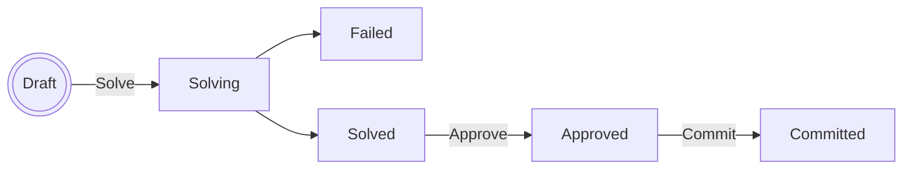

# Autoshift — Shift Optimiser for Frappe HR

Autoshift is a Frappe app that automatically assigns employees to shifts using
Mixed Integer Linear Programming (MILP). It integrates with Frappe HR data
(employees, shift types, leave applications, holidays) and produces an optimised
schedule that maximises room utilisation while respecting staff FTE targets and
shift preferences.

Autoshift is organisation-agnostic: disciplines, branches, scheduling roles,
room counts and rules are all records you create in the desk (see
[One-time Setup](#one-time-setup)), not constants in the code. Nothing about any
particular practice ships in this repo — if you are migrating off a legacy
system, that is a separate concern (for ZaWin, see the companion
[`zawin2frappe`](https://github.com/CMDBB/zawin2frappe) app).

## Prerequisites

- A Frappe v16 bench. Frappe HR (`hrms`) is a required app and is installed automatically
with autoshift; Python dependencies (`pulp[cbc]` — ships the COIN-OR CBC solver
binary — and `numpy`) are installed by bench from `pyproject.toml`.
- Redis (required by Frappe for background jobs)

## Installation

```bash
cd $PATH_TO_YOUR_BENCH
bench get-app $URL_OF_THIS_REPO --branch version-16
bench install-app autoshift
```

Installing seeds the built-in **Optimization Rule** documents and the
**Standard Ruleset** (see below). When updating an already-installed site, run
`bench migrate` as usual.

---

## One-time Setup

Before running the optimiser, configure the following in the Frappe desk.
Sections 1–3 are required; 4–6 have working defaults.

### 1. The calendar

**HR → Holiday List Assignment** — assign each company a `Holiday List`.

The optimiser reads Frappe HR's own calendars rather than keeping its own. The
company's list decides which days are worked at all: its **weekly off** rows
(weekends) are what makes the week five days, and nothing is scheduled on them.
Its dated holidays, and any list assigned to an individual employee, remove that
person's days only — see *Holiday lists per employee* below.

Without a list assigned to a company, a run refuses to start: nothing tells it
which days are worked. A list that resolves but happens to contain no rows for
the window you are planning is a different thing, and a legitimate one — it
means every day of that window is worked. If the list's own date range stops
short of your horizon, those days also come back worked, **weekends included**,
and the run says so in a warning rather than refusing.

### 2. Discipline Branch Config

**Autoshift → Discipline Branch Config** — one record per *(discipline, branch)*
combination.

| Field | Description |
|---|---|
| Discipline | Department (e.g. Dental, Hygiene) |
| Branch | Branch / location name |
| Number of Rooms | Number of treatment rooms at this branch for this discipline |
| Shift Types | Which Shift Types the optimiser schedules here; one listed nowhere is excluded as non-clinical |
| Value Of A Staffed Room | *Optional.* What one staffed room here is worth in objective points, for the **Room value** objective — see [Pricing rooms and people](#pricing-rooms-and-people). Ignored unless that rule is in your ruleset |
| Barebones | *Optional.* This discipline staffs its rooms here and nothing beside them — see below |
| Display Order Key | *Optional.* Tiebreak for where this band sits on the wall chart, used only when two bands are otherwise unordered |

At least one record is required; the optimiser will throw if none are found.

**Barebones** is for a satellite branch that runs the same rooms as the main
site and carries none of the posts built *around* them — no floater, no lead on
site, no administrative half-day. Tick it and nothing is scheduled at this
branch in any role that is not **Required To Staff A Room**, whatever mode that
role is worked in. It is per *(discipline, branch)*, so a branch can be
barebones in one discipline and fully staffed in another. Closing the rooms
themselves is a different thing: set **Number of Rooms** to 0. The flag does
nothing unless the **Barebones branches** rule is in your ruleset (it is in the
Standard Ruleset), and the wall chart still draws the suppressed columns —
empty, which is what an empty derived column is for.

### 3. Scheduling Roles

**Autoshift → Scheduling Role** — the optimiser's unit of *capability*. A role
names exactly one discipline, and an employee may hold several — which is how
somebody who works two disciplines (say an assistant who also does prophylaxis)
is scheduled without either discipline over-stating its capacity.

| Field | Description |
|---|---|
| Role Name | e.g. "Ortho Assistant" |
| Discipline | The Department this role staffs |
| Max Rooms Per Holder | Rooms one holder covers simultaneously in a single slot |
| Assignment Mode | How a shift in this role is *worked* — see below |
| Required To Staff A Room | Whether a room waits on this role. On by default — see below |
| Value Of A Shift In This Role | *Optional.* Objective points for working this role, over and above the rooms it staffs — see [Pricing rooms and people](#pricing-rooms-and-people) |
| Assignments Are Binding | *Optional.* Holders' presence is settled by their own week rather than by the planner — see below |
| Display Order Key | *Optional.* Where this role's column sits in the week wall chart — see below |
| Chip Sort Field / Descending | *Optional.* Orders the people *within* this role's column each day — see below |
| Wallchart Abbreviation | *Optional.* The column header on the wall chart. Blank derives initials from the role name |
| Highlight On Wall Chart By Default | *Optional.* Seeds the wall chart's **Highlight** picker with this role |

**Assignment Mode** says how a shift in the role is worked, and is the answer to
"people have a mostly fixed *presence* — which half-days they are in — and work
one role or another during it depending on demand":

| Mode | Meaning |
|---|---|
| **Flexible** *(default)* | A slot in this role means "this person is in". The optimiser may fill it with any non-exclusive role they hold, at any branch |
| **Exclusive** | The slot is worked in exactly this role, with nothing alongside it and no swapping out of it |
| **Collateral** | A duty worked *on top of* another shift at the same shift and branch — a lead, say. It may also stand alone: a lead whose team is fully staffed may spend the day on the lead duty only |

**Required To Staff A Room** is a separate question from the mode, and both
directions of the obvious guess are wrong. A **floater** or an administrative
role is an ordinary working role that opens no rooms — counted toward coverage
it would hold every room in its discipline shut whenever nobody is floating. And
a practice that may not run without a lead on site has a **gating collateral
duty**, which is legal here and warned about on save, since it is the strong
reading. Room coverage is the minimum over a discipline's *gating* roles only.

**An employee with no Scheduling Role is not scheduled at all.** This is how
non-clinical staff stay out of scope — `Employee.department` and
`Employee.designation` are payroll data and are not read by the optimiser.

**Display Order Key** affects presentation only, never the schedule. The week
wall chart draws one column per role of a discipline, ordered by this key
(default 0), then by Max Rooms Per Holder descending, then by name. Leave it
alone unless the derived order reads wrong: setting a practitioner role to
**-1** puts it ahead of every role still on 0, which is how you get the
practitioner column to the left of the assistant one. It also breaks the tie
when a Shift Assignment's role has to be inferred, so the chart and the
inference agree.

**Chip Sort Field** orders the people stacked inside one role's column on a
given day, which by default is alphabetical by initials. Row numbers on the
chart are drawn either way — a band's rows are numbered because chairs are — so
an alphabetical stack makes the number meaningless for anything that reads it as
more than a chair index. Name a field on Employee (e.g. `date_of_joining`) to
give the number a meaning instead: apprentices sorted by that field read in
seniority order rather than alphabetically. Check **Descending** to put the
highest value first (latest joiner in room 1, say) instead of the lowest. Leave
the field blank to keep the alphabetical default; an employee with no value for
the field sorts after everyone who has one, in alphabetical order, rather than
the chart breaking.

#### Employee Scheduling Role

**Autoshift → Employee Scheduling Role** — one record per employee-capability pair.

| Field | Description |
|---|---|
| Employee | Link to Employee |
| Scheduling Role | The capability they hold |
| Agreed FTE % in Role | *Optional.* The informally agreed share of their time in this role. Blank means no expectation |
| Max Rooms Override | *Optional.* Overrides the role's figure for this person (e.g. an apprentice covering one chair, not three) |
| Binding Override | *Optional.* Overrides the role's Assignments Are Binding for this person. Blank inherits |
| Assignment Mode Override | *Optional.* Overrides the role's Assignment Mode for this person. Blank inherits |
| Suitability | How suitable they are to work this role: **1** for a regular holder (the default), higher for a substitute — 1.2 a good backup, 3 a terrible but feasible one. Must be at least 1 |
| Value Multiplier In A Staffed Room | *Optional.* Scales this person's share of a staffed room's value — see [Pricing rooms and people](#pricing-rooms-and-people) |
| Valid From / Valid To | *Optional.* Time-boxes a capability acquired or dropped mid-year |

The Agreed FTE % is deliberately soft: the solver is *penalised* for deviating
from it (see the "Agreed role FTE split" objective rule) but never forbidden,
because these splits are normally an informal expectation rather than an
entitlement. If you do need it enforced, add the non-standard
**Agreed role FTE ceiling** constraint rule to your ruleset.

#### Settled schedules: Assignments Are Binding

**Assignments Are Binding** is for a role whose week is settled by its holders
rather than by the planner — a senior clinician whose week is fixed, say. It is
a statement about **presence**: over the run's horizon the holder is in for the
half-days their books already have, and on no others.

Which *role* they work during a settled half-day stays the optimiser's choice
among the roles they hold, because a rota settles when a person is in, not what
the demand that day turns out to be. Two exceptions: an **Exclusive** role keeps
its shift exactly as booked, and so does a **collateral** duty — neither is a way
of spending a half-day that something else could substitute for.

Binding is personal, not per role: somebody holding *any* binding role has their
presence settled on every day, and a non-binding role they also hold only widens
which role can fill a settled slot. A holder whose schedule has not settled yet
is exempted with **Binding Override = Not Binding** on their Employee Scheduling
Role, and is then scheduled normally alongside everyone else.

Two rules implement this, and your ruleset picks **at most one** of them:

| Rule | Behaviour |
|---|---|
| **Bind settled schedules** *(in the Standard Ruleset)* | A bound holder is never in on a half-day their books do not have, but the half-days they *do* have are proposed rather than nailed down. The optimiser keeps them where they pay for themselves and drops one where keeping it would make the whole schedule infeasible |
| **Bind settled schedules (strictly)** | The half-days on the books are fixed on as well. Nothing may be added, moved or dropped |

The soft rule is the default because freezing completely has one bad failure
mode: a settled week that is illegal under the rest of the ruleset — two
half-days on one date, a week over the FTE ceiling, a branch the config no
longer covers — makes the **whole run** come back infeasible, and one person's
history takes the schedule down with it. The soft rule loses that half-day
instead and still produces a schedule for everyone else. Pick the strict rule
when a settled schedule may genuinely not be touched at all; add
**Objective: Conserve Existing Assignments** for an explicit tie-break toward
keeping the booked half-days.

Two things apply under either rule. Approved (and speculated) leave wins over a
settled assignment: the colliding shift is dropped rather than making the run
infeasible, and the run-statistics panel reports it so the underlying records can
be fixed. And a day they have nothing on the books stays empty — "settled" means
settled, not "fill the gaps".

Both rules are inert while no role is marked binding, so they cost nothing on a
site that does not use this. If some role *is* marked binding and your ruleset
includes neither rule, Solve and Preview both warn before running: that
combination silently re-plans the one group whose week is not yours to set.

#### Where a settled week comes from

A bound holder's week does not have to be typed in week by week. If they have a
**Shift Schedule** and a **Shift Schedule Assignment** (stock HR's way of
recording a repeating week — a shift type, a frequency, the weekdays it falls
on), autoshift reads that pattern directly.

Stock HR is supposed to generate the Shift Assignments from a Shift Schedule on
a nightly job, and it does — as long as the frequency is *Every Week*. For
anything longer it takes its week boundary from the schedule's
**Create Shifts After** date and then moves that date forward as it goes, so the
next night's run resumes mid-pattern and the cycle drifts until a four-week rota
is firing most weeks. A fortnightly Friday or a four-week orthodontic rota
therefore cannot be switched on as it stands, and the import writes those
schedules disabled and marked *DO NOT ENABLE*.

Autoshift expands those schedules itself, correctly phased, and
**Create Shifts After** is never modified, because it is also what fixes a
rota's phase.

**A solve does not create any records.** It reads each day a bound holder's rota
puts them on that no submitted Shift Assignment covers, and treats it as though
it were already on the books — same shift type, location, role and collateral
duties. So the model is identical whether or not those records exist, and a
preview never submits real Shift Assignments (with the notifications that come
with them) for a week nobody has approved.

Records are written in exactly two places: the wall chart's **Create them**
offer, which sits behind an "N not recorded" toggle in its toolbar, and — once
it is built — Commit. Until a day is written down, the wall chart draws it as a
dotted, italic chip, so you can check the week *before* creating anything.

This is a workaround for an HR bug, not a feature autoshift wants to own. The
day the nightly job anchors its weeks properly, enabling the Shift Schedule
Assignments does the same work and this can go.

#### Correcting a settled rota

Detection from the import isn't always right — a schedule changes, or
zawin2frappe never saw it. The **Rota Editor** (a shortcut on the Autoshift
workspace) lets you fix a bound employee's rota by hand: pick a discipline, then
drag a shift to a different day, shift type or branch, or click an empty cell to
add one. Nothing is written until you click **Apply Changes** — every drag is
staged in a draft first, listed as plain English at the bottom of the page
("moved AM (Balexert) from Tue-Wed to Tue-Fri") so you can review before
committing, and **Discard Changes** drops the draft without touching anything. A
pattern that was imported rather than entered by hand is drawn with a **dotted
grey border**: it is the import's best reading of the old agenda, not yet a
confirmed schedule. Editing a pattern confirms it, since the replacement is the
authoritative record. **Promote all**, next to an employee's name, confirms the
rest of their imported patterns as they stand. A later zawin2frappe re-import
only ever updates patterns that are still unconfirmed, so neither your edits
nor your confirmations get overwritten.

**A changed pattern is ended, not deleted.** The turning point is the first day
of the window you were looking at: the old pattern stops the day before it and
the replacement starts on it, so last month's schedule still says what was
actually arranged. A pattern that had not started yet is deleted outright,
having recorded nothing. Editing a window that has already passed therefore
really does rewrite from that date — the Apply dialog says so before the fact.
Each ending is listed in the transcript under **Pattern changes**.

A rota that repeats every N weeks is shown at whatever view width you pick
(1/2/4 weeks); someone whose rota doesn't divide evenly into the current width
is left off the grid rather than shown as a fragment, with a note saying why —
widen the view to see (and edit) their full pattern. A pattern that starts
*after* the window on screen is not hidden either: it is listed above the grid
with a button that stages a request to start it from this view instead.

Every pattern records the **Scheduling Role** it is worked in. Hover a chip to
see it; **right-click** a chip to change it, picking from the roles that person
holds in this discipline. Adding a shift asks which role only when it cannot be
worked out — someone with a single role there, or a single *binding* one, simply
gets it. Patterns imported before the role was recorded have one filled in from
the same reasoning, so an employee who only ever had one role needs no work at
all; whatever is still unattributed acquires a role the first time you edit it.
Because the role is part of what a pattern *is*, re-roling one half-day of a
Mon–Wed pattern splits it into two schedules. That is intended: one Shift
Schedule Assignment can only name one role.

Someone who holds binding roles in **two disciplines** has one week, not two, so
the other discipline's shifts are drawn here as well — faint, italic and
read-only, labelled with the discipline that owns them. Open that discipline's
view to change them. Where one of them lands on the same half-day as a shift in
the discipline you are editing, both turn **red**: the person is booked twice.
Shift Types this discipline's config doesn't cover appear as extra read-only
rows at the bottom, marked with a `*`, rather than being left out of the picture.

#### The Role Matrix

The **Role Matrix** (a shortcut on the Autoshift workspace) shows Employee
Scheduling Role as one table: a row per employee, a column per Scheduling Role
(headed by its initials, as on the wall chart; hover for the full name), and the
Suitability in every cell where the employee has that role. Pick a discipline
(or all of them) and type into a cell to give someone a role or change how
suitable they are for it; clear a cell to take the role away. Tick **All
Employees** to list people who have no role there yet. Cells are coloured from
green (1) to red (3 and up), and a role that is inactive or outside its
validity window today is struck through. Hover a cell for its Agreed FTE,
overrides and validity, or click its ↗ to open the record.

The **Settings** column sums up each person's Employee Settings in one chip —
★ for a favourite shift, ↑ for the shift they weight highest, *Uniform* for
none — and opens the record in a new tab (or creates one, if they have none).

Like the Rota Editor, nothing is written until you click **Apply Changes**,
and **Discard Changes** drops your edits. Removing a role deletes its Employee
Scheduling Role, including any Agreed FTE or validity window on it.

The optimiser uses Suitability through the standard **Shift preferences and
role suitability** objective: every shift an employee works in a role costs
its usual preference cost multiplied by their suitability for that role. So
the practice prefers a regular holder over a backup, and a good backup over a
poor one, but still uses a poor backup to staff a room nobody else can. With
every Suitability at 1 this is exactly the older **Shift preferences** rule,
which you can still pick instead (they are a choice of one).

#### The Synergy Matrix

The **Synergy Matrix** (a shortcut on the Autoshift workspace) is where you say
that two particular people work well — or badly — in a room together. Pick a
discipline and you get a grid of employees against employees, filled in with
their **Synergy Multiplier**: 1 is neutral, above 1 a pair worth putting
together, below 1 a pair to keep apart.

The two axes are deliberately different groups of people. Each discipline's
room-staffing roles are split into two sides, so a practitioner's row meets the
assistants' columns and never another practitioner — pairing two holders of the
same role was never the point, and this way there is no cell for it rather than
a disabled diagonal to explain. A pair is one value however you reach it:
editing *(A, B)* and *(B, A)* edits the same thing.

Two conveniences. Each employee has a control that sets every pair in their row
or column at once, against whichever side they are not on. And the **Self** row
and column carry a different field — the **Value Multiplier In A Staffed Room**
from that person's Employee Scheduling Role — so you can price an individual
and their pairings on one screen. Clearing a self cell resets it to 1 rather
than deleting the record. Ctrl/Cmd+click picks out several cells, Shift+click
extends a rectangle, and a prompt then sets them all at once.

As with the Role Matrix, nothing is written until you apply. Both multipliers
are read only by the room-value objectives below, so this page does nothing to
a run whose ruleset does not include them.

#### Pricing rooms and people

By default a staffed room is worth a flat 3 objective points wherever it is, and
who is standing in it makes no difference. Four opt-in rules let a practice say
otherwise. They build on each other, and each one is inert until you configure
the field it reads:

| Rule | Reads | Says |
|---|---|---|
| **Room coverage per discipline (matched pairing)** | — | Rooms are numbered, and a room opens only when a *specific* holder of every gating role is matched into that *specific* room — not merely enough headcount to cover it. The prerequisite for the three below |
| **Objective: Room value** | Discipline Branch Config → *Value Of A Staffed Room* | A room is worth what its branch says, instead of the flat 3 |
| **Objective: Employee value** | Employee Scheduling Role → *Value Multiplier In A Staffed Room* | Add a flat bonus for the particular person matched into a room. 1.25 on a room worth 4 scores 4 + 1 = 5 — added, never compounded |
| **Objective: Synergy value** | Employee Role Synergy → *Synergy Multiplier* | Add a flat bonus when two particular people are matched into the same room, on top of the room's value and any employee bonus already earned there |

All four are **off by default**. Matched pairing is a materially larger model
than a headcount minimum — every room multiplies the variable count — so it is
worth its solve time only where one of the value rules is actually in use. The
pooled **Room coverage per discipline** stays the default.

Separately, and on by default, **Objective: Value of working a role** reads
*Value Of A Shift In This Role* on the Scheduling Role. It answers the question
room coverage cannot: whether somebody the schedule has no room for is better on
a standby or float role than left at home. A role at the default of 0
contributes nothing; above about 1 a standby role starts to win against sending
somebody home; a negative figure makes a role a last resort.

### 3b. Holiday lists per employee

Frappe HR charges leave by subtracting an employee's own holidays from the days
they apply for. An employee whose settled week is four days, holding only the
company calendar, is therefore charged five days for a week off.

The Rota Editor's **Update Holiday Lists…** menu item fixes that from the rotas
it already edits. It shows who no longer matches their pattern and from when,
then assigns each of them a `Holiday List` built from the company calendar plus
every day their rota leaves free. Employees working the same week share one
list. Nothing is edited or deleted: a changed rota creates a new list and a new
assignment starting on the day the week actually changed, so leave approved
under the old one keeps the numbers it was approved with.

`bench --site <site> update-holiday-lists [--dry-run]` does the same in bulk,
for the first run.

Two limits are worth knowing. Only employees with a **binding** Scheduling Role
get one, because nobody else has a settled pattern to derive a list from. And
only whole days can be expressed — Frappe HR counts a half-day holiday as a
full day off — so an employee who works five mornings gains nothing from this.

What the *optimiser* reads back is narrower still: only the dated holidays on
these lists, never the rota-derived days off. Which days a bound employee works
is decided by the role-binding rules in your ruleset, not by their holiday list.

### 4. Employee Settings *(optional per employee)*

**Autoshift → Employee Settings** — one record per employee to override defaults.

| Field | Description |
|---|---|
| Employee | Link to Employee |
| Favourite Shift | If set, the optimiser strongly prefers this shift for the employee |
| Shift Preferences | Table of (shift type, weight) pairs; normalised automatically |
| Preferred Branch | Table of preferred branches. *Not yet read by the optimiser — setting this field has no effect on a run today* |

Employees without an Employee Settings record use a uniform shift preference and
their `custom_fte` field value (set directly on the Employee doctype) for the
FTE target.

### 4b. Bulk Employee Settings *(a shortcut for the two records above)*

**Autoshift → Bulk Employee Settings** creates the two per-employee records —
**Employee Settings** (preferences) and **Employee Scheduling Role** (the
capability that makes somebody schedulable at all) — for many employees at once,
so a new site does not need them entered one by one.

Fill in the template at the top (favourite shift and shift/branch preferences
for the Employee Settings action; scheduling role, agreed FTE, max-rooms
override and validity window for the role action), then narrow the employee list
with the filters:

| Filter | Description |
|---|---|
| Company | Restrict to one company |
| Discipline | Employees who hold a Scheduling Role in this Department |
| Holds Role | Employees who hold this specific role |
| Coverage | *All Employees*, *Without Employee Settings*, or *Without Any Scheduling Role* — i.e. "who is still missing one of these" |

Tick the employees you want and run the action.
**An employee who already has the record is skipped, never overwritten**, so it
is safe to re-run over a partly configured site; use it to fill gaps and edit
the exceptions by hand afterwards. Up to 30 employees are processed immediately;
a larger selection runs as a background job with a progress bar.

### 5. Employee FTE

On each **Employee** record, fill in the **FTE %** field (0–100). This
determines the target number of shifts for the planning period. Employees
default to 100 % FTE if the field is blank.

### 6. Optimization Rules & Rulesets

The constraints a run enforces — and the objective terms it maximises — are
documents, not hardcoded behaviour.

**Autoshift → Optimization Rule** — one document per rule. Each rule has a
natural-language **Description**, a **Rule Kind** (`Constraint`, `Objective`, or
`Mixed`; derived from code for built-ins, declared by the developer for custom
code) and an optional implementation:

| Implementation Type | Meaning |
|---|---|
| `Not Implemented` | The rule exists only as its description — a backlog item for a developer (or an LLM, pending developer validation) to implement later |
| `Built-in` | Points at a rule shipped in the app code via **Built-in Key** (registry in `autoshift/optimizer/rules.py`) |
| `Custom Code` | Python on the document defining `apply(ctx)`; it only runs after a developer checks **Validated by Developer** (editing the code clears the flag) |

**Each built-in rule's own Description is the reference for what it does** — it
is written for a planner, it says what the rule costs and what it rewards, and
it cannot drift from the code because it ships with it. Open the rule, or hover
it in Optimizer Studio's panel. For the arithmetic, see
[`docs/formulation.md`](docs/formulation.md).

The Implementation Code editor assists authoring: autocompletion for the rule
API (`ctx.…`, `ctx.data.…`, `pulp.…`, `itertools.…` — introspected server-side
from the real classes) and inline lint squiggles from
[Ruff](https://docs.astral.sh/ruff/) running as WebAssembly in a browser worker
(via [ace-linters](https://github.com/mkslanc/ace-linters); self-hosted, no
external requests). The lint assets come from the app's npm dependencies — run
`yarn install` in `apps/autoshift` followed by `bench build` once per bench
(completions work regardless).

Only implemented rules can be used in a solve. Because writing and validating
rules takes time, rules are bundled into an **Optimization Ruleset**
(**Autoshift → Optimization Ruleset**) — a reusable, ordered list of rules that
every Optimizer Run points to. Each ruleset row carries a **Weight** that
multiplies the rule's objective contribution (it has no effect on constraint
rules — saving warns if you set one there).

Some rules are **alternatives to one another** — two readings of the same
policy, such as the hard and soft FTE ceilings, or the pooled and matched
readings of room coverage. A ruleset may hold at most one of each such set, and
"neither" is always a legal answer. Saving a ruleset that breaks this is
refused; Optimizer Studio's panel makes it unreachable in the first place.

Migration seeds one Optimization Rule per built-in and a **Standard Ruleset**,
the default for new runs. The Standard Ruleset holds the subset that suits most
sites; the remaining built-ins ship as rules you can add to a ruleset of your
own. Unimplemented rules may sit in a ruleset as a draft, but a run using that
ruleset refuses to solve until they are implemented.

Each rule may name a **Scheduling Rule Topic**
(**Autoshift → Scheduling Rule Topic**), which is purely a heading: it groups
the rule into a collapsible section in Optimizer Studio's rule panel and
constrains nothing. The built-in topics are seeded and re-synced on every
migrate; topics you create yourself are never touched, and a Custom Code rule
may file itself under any of them.

A ruleset with no `Objective`/`Mixed` rule gives the solver nothing to maximise
— it returns an arbitrary feasible schedule (typically nobody assigned). Saving
such a ruleset warns but is allowed, since it's useful for pure feasibility
checks. **Note for rulesets created before objective rules existed:** only the
Standard Ruleset is upgraded automatically; add the objective rules to your own
rulesets yourself.

> **Security note:** Custom Code rules execute as ordinary Python at solve time,
> so implementing and validating rules is developer-only. **HR Manager** can
> create and edit rules, but only the name and NL description: the
> implementation fields (Implementation Type, Built-in Key, Implementation Code,
> Validated by Developer) are read-only for everyone except **System Manager**
> (field permission level 1). The server enforces this independently of the UI —
> a non-developer's attempted implementation change is cleaned up with a warning
> (new rules are forced to `Not Implemented`), and setting
> *Validated by Developer* is refused outright.

---

## Running the Optimiser

There are two ways in. **Optimizer Studio** is the quicker one and the place to
start; the **Optimizer Run** form below is the full record, and is what Studio
drives underneath.

### Optimizer Studio

**Optimizer Studio** (a shortcut on the Autoshift workspace) puts the planning
mode, the start date and the rules on one page, so you can try a ruleset and
look at the result without creating and saving a run first.

The **schedule itself is at the top of the page**, with the rule panel
underneath it: you are looking at the week and reaching down to adjust it, not
filling in a form and waiting to see what comes out.

The rule panel lists every implemented rule in plain language, grouped into
collapsible sections by Scheduling Rule Topic.
**It cannot express a ruleset that would fail**, which is the point of it:

- Rules that are alternatives to one another are **radio buttons**, including an
  explicit *None* — so you cannot pick two answers to the same question. The
  treatment of existing Shift Assignments, the two readings of role binding and
  the two readings of room coverage are all of this kind.
- A rule that only makes sense on top of another is drawn **inside** it, its
  checkbox disabled until the parent is ticked.
- A rule that contradicts one you have ticked is greyed out, and hovering it
  says which rule blocked it.

Objective rules carry a **weight** box next to them; constraint rules do not,
because a weight would do nothing there.

**Preview Schedule** solves and renders the result in the same four-pane
[Schedule View](#step-3--review-the-solution) the run form uses. Each preview
really does create an Optimizer Run — with **Type = Automatic**, so these are
hidden from the Optimizer Run list and workspace by default and do not clutter
the record of runs you made deliberately.

Your toggles live in a private working ruleset (`Studio Draft — <your user>`),
overwritten on each preview rather than piling up. The seeded presets are never
edited in place — picking one copies it into your draft. Three other controls:

| Control | Effect |
|---|---|
| **Load Ruleset** | Copy any saved ruleset's rules and weights into the panel (it starts on **Standard Ruleset**) |
| **Populate From Run** | Load an existing run's mode, date and rule selection into the panel |
| **Save Ruleset As** | Promote your current draft to a permanent, named Optimization Ruleset |

**Load Ruleset** also shows what the panel was last seeded from, including after
a Populate From Run or a Save Ruleset As. It is a copy, not a link: editing the
toggles afterwards never touches the ruleset named there. Clear it and pick the
same ruleset again to throw your edits away and start from it afresh.

Before solving, Studio checks two things and asks about them in one prompt:
whether any bound employees' rotas in the horizon are still **unconfirmed** (it
links you to the Rota Editor per discipline, and does not block), and whether
roles are marked binding while your selection includes **neither** role-binding
rule — because that would silently re-plan the one group whose week is not
yours to set. Neither check creates any records.

The **Week** wall chart is available in Studio before you have previewed
anything at all: with no run to show, it falls back to the Shift Assignments
already on the books, so it doubles as a way to look at any week.

### Step 1 — Create an Optimizer Run

**Autoshift → Optimizer Run → New**

| Field | Description |
|---|---|
| Planning Mode | `1-week`, `2-week`, `4-week`, or `Unbounded` |
| Start Date | First Monday of the planning period (any day for Unbounded) |
| Optimization Ruleset | Which rules constrain this run; defaults to **Standard Ruleset** |
| Pending Leaves to Treat as Approved | Optional: select pending Leave Applications to block as if approved |

Save the document. Status is **Draft**.

How existing Shift Assignments are treated is no longer a run field — it's a
choice of which rules the run's Ruleset includes:
`Honor existing Shift Assignments` fixes them as hard constraints,
`Objective: Conserve Existing Assignments` treats them as a soft tie-break the
solver may override, and including neither disregards them.
**The Standard Ruleset includes neither**, so by default the books are a
tie-break and not a constraint: a practice's own history is rarely feasible
under the rest of the ruleset — weeks worked short-handed, double-booked or
against the current room configuration — and pinning it makes the run unsolvable
rather than realistic. The people whose week genuinely is not yours to set are
handled by the role-binding rules instead.

> **Not yet usable:** `Unbounded` planning mode is selectable in the UI but
> raises `NotImplementedError` when you try to solve — only
> `1-week`/`2-week`/`4-week` are implemented today.

### Step 2 — Solve

Click **Solve**. There's only one button: the optimiser first attempts to solve
synchronously within a short time limit (a few seconds) — for normal practice
sizes this finishes immediately and the form reloads with the result.

If CBC doesn't reach a conclusive result within that short window, Autoshift
automatically re-queues the same problem as a background job with the full
timeout, and the page polls every 5 seconds until it finishes. No separate
"background" action is needed.

Status becomes **Solved** on success or **Failed** if no feasible schedule
exists. A failed run gets a diagnosis appended to its **Solver Log** — CBC only
ever says the word "Infeasible", so autoshift replays the pinned assignments
against the selected rules and names the Shift Assignment that cannot hold.

### Step 3 — Review the Solution

The **Schedule View** tab carries four ways of reading the run, and is up in
every state — including a Draft you have not solved yet and a run that failed.

| Pane | What it answers |
|---|---|
| **Week** | *Is the practice covered?* A one-week wall chart: treatment rooms down the page, days across. Always available |
| **Statistics** | *Is the schedule full, and if not, why?* Coverage meters, FTE gaps, each rule's share of the objective |
| **Roster** | *What did this person get?* The per-employee grid, with existing assignments and leave alongside |
| **Solver Log** | CBC's raw output and the infeasibility diagnosis. Available on a failed run too |

Each rule's share of the objective **opens into a tree** of where it was earned
— down to the discipline, branch, day and shift a room was staffed in, or the
employee a penalty was charged to. That is usually the fastest way to see what a
weight is actually buying you.

#### The Week chart

The chart is built entirely from your configuration: one band per
*(branch, discipline)* from **Discipline Branch Config**, as many numbered rows
as it has rooms, and one column per **Scheduling Role** of that discipline. So
an unstaffed room is a blank row and a role nobody covers is a blank column —
you can see a gap without reading a number. Use ◀ ▶ to move between weeks.

A row that is not a *fully* staffed room is hatched on screen: a room with a
practitioner and no assistant is not an open room, and the headline counts only
the ones that are.

Where the ruleset uses **Room coverage per discipline (matched pairing)**, the
row a chip sits on **is** the room the solver matched it into — hover a chip to
see which — and two people the solver put in the same room are drawn side by
side on that row. Nothing in the optimiser prefers one room to another, so a run
may well work rooms 2 and 3 and leave room 1 shut: that shows as an empty top
row, and it is not a mistake. Shuffling the chips up to close the gap would show
you a schedule the run did not produce.

Somebody covering more than one room appears **once per room** rather than as
one chip stretched over several rows, for the same reason: their rooms need not
be next to each other, and two practitioners' rooms can interlace.

Before the run is solved the chart shows the
**Shift Assignments already on the books**. Once it is solved, each cell says
what the run did with that half-day:

| | |
|---|---|
| **Kept** | already on the books, and the run scheduled it again |
| **Added** | proposed by the run; nothing on the books for it |
| **Dropped** | on the books, and the run did **not** schedule it |
| → | kept, but moved — hover for what changed |
| ★ | pinned rather than chosen (a binding role, or an existing assignment being honoured) |
| *dotted, italic* | a bound employee's rota day that no Shift Assignment records yet |

Anyone the chart cannot place — a role with no Discipline Branch Config, a
branch with no config, a Shift Type the config omits — appears under
**Unplaced** with the reason stated above the chart, so nobody is ever quietly
missing.

**People on leave are listed under the half-day their leave emptied** — the
morning table under the morning chart, the afternoon under the afternoon. HR
records a half-day's leave without saying which half, so autoshift works it out
from what that person would otherwise have been doing that day. Somebody off all
day is listed under both; somebody with neither a rota nor a booking to go on is
listed in a leftovers row at the foot, with no half named. A leave day that
emptied nothing — a weekend inside a month-long absence, a four-day week's day
off — is not reported at all, because reporting it only says the leave is long.

**Four pickers** sit above the chart:

| Picker | Effect |
|---|---|
| **Disciplines** / **Branches** | Narrow the chart to those bands. Everything follows — the sections, the coverage headline, the leave list. An empty selection means *all*, never none, and the row says how many chips a filter is hiding |
| **Days worked** | Which weekdays the practice runs, for a site whose Holiday List doesn't say yet. It **narrows and never widens** — "All days" cannot reopen a day the Holiday List closed, because the list is the only answer a solve reads. It drives the working-day shading, the headline's capacity, and which days a leave can have emptied |
| **Highlight** | Marks the holders of the chosen roles wherever their chip appears, *including* a half-day they worked in some other role — so an apprentice stands out whatever they are covering. It hides nothing. Seeded from **Highlight On Wall Chart By Default** until you touch it |

**Export PDF…** opens a dialog rather than printing straight away, because the
answers are per-print: which disciplines and branches, a heading, working days
only, whether to include the leave list and the coverage summary, one table per
shift type (so a page break lands between bands), orientation and text size.

Its **Finished sheet** option is on by default, and drops everything that says
where a chip came from — the kept/added/dropped colours, the ★ and →, the
borders, the legend and the warnings. What is left is next week's schedule,
which is what somebody pinning it to a wall wants. A dropped chip still prints,
in italics under a dashed underline, because hiding a scheduled person is the
one thing this chart never does.

The printed sheet is **ink only** — no fills, no shading, no hatching. That is
not a style choice: browsers print with background graphics off by default and
silently drop every background colour, so a sheet that said anything that way
would say it only in the preview window. An empty seat prints as a dot instead.

The **Assigned Slots** table on the first tab remains the raw record: employee,
shift type, date, branch, and whether the slot was forced. The
**Objective Value** is the raw MILP score (higher is better).

### Step 4 — Approve

Click **Approve**. This locks the solution. Status becomes **Approved**.

### Step 5 — Commit

Click **Commit**. Autoshift creates and submits one **Shift Assignment** record
per slot. Status becomes **Committed**.

> **Currently not functional:** how a committed run stays linked to the Shift
> Assignments it creates is being redesigned
> ([#5](https://github.com/CMDBB/autoshift/issues/5)), and until that lands
> Commit raises `NotImplementedError` — the run stays **Approved** and no
> records are created.

---

## Scanning the Horizon

A run answers "is next week covered". The **Horizon Scanner** (a shortcut on the
Autoshift workspace) answers "what breaks between now and March": it solves
every week from a start date to a date ahead — one ordinary Optimizer Run per
week, under one ruleset — and draws the result as month calendars, with each day
coloured by how its week came out.

**Start one** from the page's **New…** button: a ruleset, a start date (snapped
back to its Monday), a date to scan until, and optionally a different window
length (2- or 4-week windows solve fewer, larger problems) and a per-window time
limit. Windows never overlap, so every day is judged once, by one run.

**What the colours mean**, worst finding of the day winning:

| Colour | Meaning |
|---|---|
| **green** | every room that could be staffed was staffed |
| **blue** | somebody ended the week under their FTE target, with every room staffed |
| **amber** | a room went unstaffed, or an existing assignment clashed with a leave |
| **red** | a configured room-slot was shut — nobody in it at all |
| **dark red** | the week had no feasible schedule at all |
| **dashed** | not scanned yet |
| **grey** | not a working day |

The square's mark tells you which it is at a glance: `−3` three room-slots
short, `⚑` a conflict, `·` under FTE, `!` no schedule.

**Click a day** for its figures — staffed vs. configured rooms per discipline,
branch and shift, the conflicts, who is under FTE — and that week's **wall
chart** opens underneath it. The run behind the day is one click further
(**Open run**), with its statistics and solver log, which is where a failed week
explains itself.

**"Only flag missing flexible staff"** changes what a shortfall is measured
against. Off, it is the configured room count: four rooms with two staffed is
two short, whoever was available. On, it is what the people actually scheduled
in **Exclusive** gating roles could have opened — so a day only two
practitioners worked counts as two rooms, not four, and only a missing assistant
around them is reported. The first reading answers "is the practice running at
capacity", the second "did the schedule waste anybody". Both figures are stored,
so the switch is instant and nothing is re-solved.

**Scanning can be stopped and picked up again.** Each week is saved the moment
it is solved, so **Stop** (which finishes the week in flight, then pauses),
a worker restart, or a window that runs out of time all leave the same thing: a
scan that knows exactly which weeks it still owes you. **Resume** solves those.

**Re-running is cheap.** Re-run all, or one window from the day panel, after
editing a rota or a ruleset: a window whose inputs have not changed re-links the
run it already has instead of solving again (the same input-hash check described
under *Detecting identical inputs*), so only what your edit actually touched is
re-solved.

A scan needs a **background worker** (`bench worker`, or run the bench via
`bench start`); it will tell you if there is none. Without one — or to watch a
long sweep in a terminal — run it in the foreground:

```bash
bench --site mysite scan-horizon --until 2027-03-01
bench --site mysite scan-horizon --scan HS-2026-11-02-001   # resume an existing scan
```

A scan creates no Shift Assignments and changes nothing: it is dozens of solves,
and a solve only reads.

---

## Status Lifecycle



| Status | Meaning |
|---|---|
| Draft | Ready to solve |
| Solving | Solver is running |
| Solved | Optimal solution found; awaiting review |
| Failed | Solver found no feasible solution, or an error occurred |
| Approved | Solution locked by user |
| Committed | Shift Assignments created |

---

## Re-running, Restarting, and Stopping a Run

Optimizer Runs are **immutable** once solving starts: there is no in-place
reset, cancel, or re-solve of the same document. Instead, every form (except
Draft) shows **Re-run (New Copy)**, which creates a brand-new Draft run with the
same Planning Mode, Start Date, Optimization Ruleset, and Leave Speculations,
and takes you to it. The original run is left exactly as it was — a permanent
record of what was tried and what happened.

This single action covers every case:

- **Re-run a Failed run** — diagnose via the Solver Log, then duplicate and
  click Solve again.
- **Get a fresh solution for a Solved/Approved/Committed run** — duplicate,
  optionally tweak the new Draft's settings, then solve.
- **"Stop" a stuck Solving run** — just duplicate and move on with the new run;
  the original keeps running in the background and will eventually settle into
  Solved or Failed on its own, but you don't need to wait for it.

The new run is created with **Type = Copy**, distinguishing it from a manually
created run (**Manual**) or one created by an automated tool (**Automatic**,
which is what Studio previews are). Copy and Manual runs both show up in the
Optimizer Run list and workspace by default; **Automatic** runs are hidden from
both by default (the type filter can be cleared to see them).

### Detecting identical inputs

Clicking **Solve** first fingerprints the run's input (employees, leaves, FTE
targets, preferences, the resolved ruleset, etc.) and checks whether another run
already solved that exact same input. If a match is found, you get an
**"Identical run detected"** prompt linking to the existing run, but you can
press `yes` to re-run anyway.

The Input Hash is only ever recorded on a run that actually went through a real
solve attempt, which is also how matches are found for *future* runs.

---

## How the Optimiser Works

The MILP model is built with [PuLP](https://coin-or.github.io/pulp/) and solved
by the embedded COIN-OR CBC binary.

**Decision variables**

- `p[employee, shift, day, branch]` ∈ {0, 1} — **presence**: is this person in
for that half-day at all. This is what a settled week fixes, and what workload
limits are counted against.
- `x[employee, role, shift, day, branch]` ∈ {0, 1} — what they *spend* that
half-day on. Variables exist only for roles the employee actually holds, and
only on days they are available, so eligibility and holidays are **structural**
rather than constraints — there is nothing to forbid, because there is nothing
to set.
- `active_rooms[discipline, shift, day, branch]` ∈ ℤ≥0 — rooms staffed in each
slot, bounded above by the branch's configured room count.

One working role per presence, collateral duties alongside it, and no presence
spent on nothing are built into the model itself rather than being rules: they
are what `p` *means*, so no ruleset can switch them off.

**Everything else is a rule.** Both the constraints and the objective terms come
from the run's Optimization Ruleset, one Optimization Rule document per group —
26 built-ins at present. Rather than restating them here, where they would go
stale:

- **What each one does, in plain language** — the rule's own **Description**, in
  the desk or in Optimizer Studio's panel. Which of them are in the Standard
  Ruleset is visible there too.
- **The exact arithmetic** — [`docs/formulation.md`](docs/formulation.md), one
  section per built-in, with the constraint names the model actually carries so
  a row in `bench diagnose-model`'s output can be looked up directly.
- **Why a rule is shaped the way it is** —
  [`docs/design-notes.md`](docs/design-notes.md).

Broadly, the built-ins cover: one presence per employee per day; approved and
speculated leave; how existing assignments and settled weeks are treated; room
coverage per discipline (pooled or matched into numbered rooms); barebones
branches; max rooms per holder; FTE ceilings, hard and soft; agreed role FTE
splits; shift preferences and role-substitution suitability; and the pricing of
rooms, roles, individual holders, pairs of holders, collateral duties and room
load.

Validated Custom Code rules can add further constraints and/or objective terms
(`ctx.add_objective(expr)`) on top of — or instead of — the built-ins.

---

## Limitations & Out of Scope

Current modelling limitations (revisit if the underlying assumption stops holding):

- **No AM/PM fairness term.** Nothing currently balances how AM vs. PM shifts are
  distributed across employees.
- **Nothing spreads coverage across days.** A discipline short of a scarce role will clump —
  fully staffed on three days and empty on the fourth — rather than thin itself out evenly.
- **Room counts are static for the whole planning period.** Discipline Branch
  Config doesn't support rooms going offline for part of a run (e.g. maintenance, partial
  closures).
- **Leave Application is the only day-level blocker.** There's no modelling for on-call
  duty or other external commitments that should also block a slot.
- **Rooms have no persistent identity.** Matched pairing numbers them `1..N` within a run,
  but the numbers are bare ordinals — they are not tied to a `Shift Location` record, and
  room 2 in one run is not room 2 in the next.
- **No minimum rest gap between shifts.** Moot today since each employee gets at most one
  shift per day; would need revisiting if night shifts or extended hours are introduced.
- **Rule weights are per-ruleset, not per-run.** Reweighting objective terms for a single
  run means duplicating the ruleset (or using Studio's draft).
- **Branch preferences are stored but not read** by the solver.
- **A substitute in a binding role does nothing yet.** A substitute row inherits the
  binding flag, and with nothing on the books in that role both binding rules pin them
  to zero there.

Out of scope for this app — handled elsewhere in the Frappe HR / ERPNext stack:

- Payroll calculation (ERPNext salary structures)
- Revenue/turnover tracking per doctor per shift (ERPNext Healthcare or Invoicing)
- Patient appointment scheduling (separate system)
- Real-time attendance tracking (Frappe HR check-ins)

---

## Development

Python tooling runs through [uv](https://docs.astral.sh/uv/) using the app's `pyproject.toml`
dev dependency group (`uv sync` once to create `.venv`).

### Unit tests (pure Python, no site needed)

Everything that can be Frappe-free is: the optimizer engine (minus `data_loader`),
the wall chart's placement arithmetic, and the rota package's cycle, edit and
calendar maths. All of it is covered by a fast pytest suite.

```bash
cd apps/autoshift
uv run pytest tests/
```

### Integration tests (need a Frappe site)

Doctype-level tests (solve lifecycle and caching, the developer-only rule
implementation/validation gate) run with bench, the same way CI does. Run them
only against a **disposable, never-served test site** — never against a site
whose state you care about. They must pass on a freshly created site; if a test
needs records, seed them in the test itself rather than relying on site state
(and prune Frappe's recursive test-record generation with
`IGNORE_TEST_RECORD_DEPENDENCIES` — see `test_optimizer_run.py`).

```bash
bench new-site dev.test.localhost --db-root-password <pw> --admin-password <pw>
bench --site dev.test.localhost install-app autoshift
bench --site dev.test.localhost set-config allow_tests true

# full suite, as CI runs it:
bench --site dev.test.localhost run-tests --app autoshift
# or a single module:
bench --site dev.test.localhost run-tests --module autoshift.autoshift.doctype.optimizer_run.test_optimizer_run
```

Note: creating a new site can steal `default_site` in `common_site_config.json`
— point it back at your development site so the test site is never served.

### Diagnosing an infeasible run

A Failed run already carries a diagnosis in its Solver Log. For more, or for a
run you want to pick apart offline:

```bash
bench --site YOUR_SITE diagnose-model --run OR-0001
bench --site YOUR_SITE capture-datapackage --run OR-0001 --output snapshots/
bench diagnose-model --snapshot snapshots/OR-0001.json --lp /tmp/m.lp   # no site needed
```

### Linting

```bash
pre-commit install # once
pre-commit # then
```

Configured hooks: **ruff** (lint + format), **eslint**, **prettier**,
**pyupgrade** — run on every commit and by CI on PRs.

CI additionally runs Frappe's Semgrep correctness rules, pinned via the
`frappe-semgrep-rules` git submodule. To reproduce locally, initialise the
submodule once, then scan:

```bash
git submodule update --init frappe-semgrep-rules
uv run semgrep scan --config ./frappe-semgrep-rules/rules --config r/python.lang.correctness
```

### Front-end assets

The app has npm dependencies (`package.json`): `ace-linters` +
`ace-python-ruff-linter` power the in-browser lint of Custom Code rules.
`bench setup requirements` (or a manual `yarn install` in `apps/autoshift`)
installs them; `bench build` then symlinks `node_modules` into served assets
(`/assets/autoshift/node_modules/…`), from which `optimization_rule.js`
lazy-loads them only on the Optimization Rule form.

### Adding dev data

`dump-dev-data` / `seed-dev-data` move **Autoshift's own configuration** between
sites — Holiday List, Scheduling Role, Discipline Branch Config, Employee
Scheduling Role, Employee Settings and Optimizer Settings. They deliberately do
*not* cover Company, Branch, Department, Designation, Shift Type or Employee:
those are upstream HR data, and the records these link to must already exist on
the target site before you seed.

```bash
bench --site YOUR_SITE dump-dev-data --output ./dev_data   # snapshot a configured site
bench --site YOUR_SITE seed-dev-data --input ./dev_data    # restore onto another
```

Existing records are left alone unless you pass `--overwrite`. Don't seed dev
data into the test site — keep it pristine.

A dump contains real employees and leave records from whichever site produced
it, so `dev_data/` is gitignored. The same goes for `snapshots/`: a
`capture-datapackage` output embeds live branch/discipline/employee data. Don't
commit around either.

---

### Documentation map

| File | Holds |
|---|---|
| `README.md` | this file — using the app |
| [`docs/formulation.md`](docs/formulation.md) | the exact arithmetic every built-in rule puts into the model |
| [`docs/design-notes.md`](docs/design-notes.md) | *why* things are the way they are — postmortems, upstream bugs being worked around, decisions that look arbitrary without the reasoning |
| `CLAUDE.md` (root, and one per package) | what the code currently does, for anyone working on it |

None of the last three are needed to use the app.

---

## License

GPL-3.0
